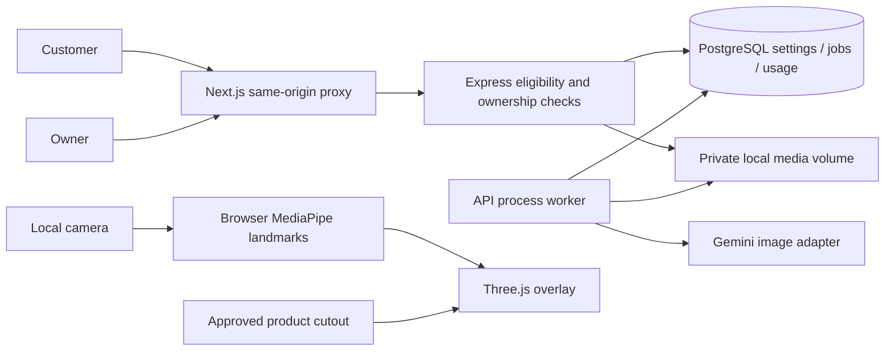

# Virtual try-on architecture

**IMPLEMENTED — 5 November 2026.** This implementation extends the existing Next.js/Express/Prisma application. Existing owner authentication and catalogue services remain authoritative.

## Photo lifecycle

A consented raw image is decoded, validated and re-encoded. The API writes a private input, then atomically reserves a daily attempt and creates an owner-bound QUEUED job. A PostgreSQL advisory lock serializes quota and idempotency decisions. The API returns 202 without waiting for generation. The worker polls every three seconds, atomically claims one queued job with SKIP LOCKED and sets PROCESSING. It rechecks publication, category, SKU eligibility and reference, calls the provider, validates the result and conditionally stores COMPLETED. A failed job exposes a safe error code. At most one explicit retry is allowed; provider calls are never automatically retried.

Deletion revokes access before removing files and job metadata. If deletion races with generation, completion cannot resurrect the job. Abandoned processing jobs become INTERRUPTED after five minutes and cannot be retried automatically. Every tick cleans expired jobs; file sweeps recover orphans with a five-minute grace. Admission, worker claims, ownership and expiry use the same bound application timestamps against timestamptz columns. Keep host clocks synchronized across replicas.

## Data additions

Migration `20261104000100_tryon` adds TryOnConfiguration, its category relation, ProductTryOnAsset, TryOnJob, TryOnUsage and enums. It adds bounded calibration/settings checks and owner/request-key uniqueness. Existing product, category and image models gain inverse relationships. No existing table or data is dropped. Usage records deliberately outlive private jobs; they retain opaque attempt identifiers and counts, not portraits or guest hashes.

## Runtime boundaries

The worker runs inside the long-lived Express process. This is not a serverless queue. API replicas must share the same private persistent volume; database locking alone does not distribute files. In-memory IP rate limits are per process; the database daily quota is global. When the API is stopped, expiry checks still apply when it resumes, but physical deletion waits for the worker. Production deployment needs monitoring, OS access controls, backup exclusion and sufficient disk space. Deployment is outside this task.

Live AR uses local MediaPipe model files and a dynamically loaded Three.js renderer. Frames and landmarks stay in the browser. It supports calibrated 2D earrings and necklaces, not volumetric fitting or physical dimensions. See [implementation](VIRTUAL_TRYON_IMPLEMENTATION.md) and [security](VIRTUAL_TRYON_SECURITY.md).
