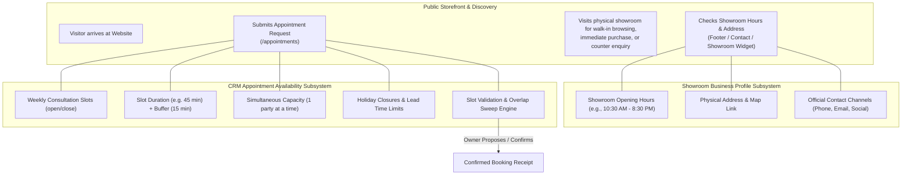

# Shree Ram Jewellers — Business Settings Implementation Plan

**Milestone Target:** Milestone 6 (Website Settings & Business Profile Management)  
**Document Status:** Implementation Architecture & Technical Blueprint  
**Prerequisites:** Completed and countersigned [Business Profile & About Us Approval Worksheet](BUSINESS_PROFILE_AND_ABOUT_US_WORKSHEET.md)  
**Authoritative Review References:**  
- [Privacy Policy Draft](PRIVACY_POLICY_DRAFT.md) (Customer data protection, retention, and contact disclosures)
- [Terms Draft](TERMS_DRAFT.md) (Storefront terms, pricing transparency, and appointment stipulations)
- [Showroom Details Module](../../apps/web/src/lib/showroom-details.ts) (Current static configuration)
- [CRM Availability Specification](../CRM_WORKFLOW.md) & [Appointments API](../APPOINTMENTS_API.md)

---

## 1. Executive Summary & Purpose

Currently, the Shree Ram Jewellers web platform manages showroom contact and address information via static frontend constants in `apps/web/src/lib/showroom-details.ts`, while CRM appointment booking rules are stored in the database via `PUT /api/admin/availability`.

This plan details the technical roadmap to transition showroom profile attributes, walk-in opening hours, verified contact channels, and editorial content into an owner-manageable, audited, and strictly validated settings subsystem—without disrupting the live storefront or CRM availability rules.

### Core Architecture Principles
1. **Zero Unverified Publication:** Unconfirmed fields remain `null` or unrendered on the public storefront.
2. **Clear Domain Separation:** Maintain a strict distinction between **Showroom Opening Hours** (public walk-in doors) and **Appointment Availability** (CRM consultation slots).
3. **Safety & Auditability:** All changes to business settings require owner authentication, same-origin CSRF protection, comprehensive schema validation, and immutable audit logs.
4. **Resilient Fallback:** The public storefront must gracefully fall back to verified static defaults if the settings API is unreachable.
5. **Separation from Production / DB at this stage:** This implementation plan documents the architecture for future execution; no database migrations or schema alterations are executed during this review phase.

---

## 2. Domain Separation: Showroom Hours vs. Appointment Availability

A critical requirement of the platform is preserving the clear boundary between general showroom walk-in hours and appointment consultation schedules:



### Key Differences
- **Showroom Opening Hours:** Informational only. Represents when the physical shop doors at Katrak Road are open. Changes do not alter existing booking calendar math or invalidate booked appointments.
- **Appointment Availability:** Algorithmic and transactional. Enforces mathematical slot intervals, concurrent room/consultant capacity, holiday blackouts, and buffer periods for private jewellery consultations.

---

## 3. Data Model & Database Architecture (Proposed for Milestone 6)

The business settings model will be implemented as a singleton record in PostgreSQL via Prisma:

```prisma
model BusinessProfile {
  id              String   @id @default("singleton")
  legalName       String   @db.VarChar(200)
  tradeName       String   @db.VarChar(200)
  gstin           String?  @db.VarChar(15)
  bisHallmarkId   String?  @db.VarChar(50)
  address         String   @db.VarChar(500)
  mapUrl          String?  @db.VarChar(500)
  phone           String?  @db.VarChar(16)
  email           String?  @db.VarChar(254)
  whatsappNumber  String?  @db.VarChar(16)
  socialProfiles  Json     @default("[]") // Array of { label: string, url: string }
  showroomHours   Json     @default("[]") // Array of { day: 0-6, open: "HH:mm", close: "HH:mm", closed: boolean }
  aboutStory      String?  @db.VarChar(10000)
  updatedAt       DateTime @updatedAt
  updatedBy       String?  @db.VarChar(100)
}
```

### Constraint & Invariant Rules
- **Singleton Enforcement:** The primary key `id` is fixed to `"singleton"`. Insert operations use `upsert` semantics to guarantee a single authoritative configuration record.
- **Strict Format Validation:**
  - `phone` & `whatsappNumber`: Must conform to E.164 international format (`^\+[1-9]\d{7,14}$`).
  - `email`: Must satisfy standard RFC 5322 email regex and maximum 254 characters.
  - `mapUrl` & `socialProfiles[].url`: Must strictly begin with `https://`, contain valid domain syntax, and reject any embedded credentials, javascript pseudo-protocols, or relative traversal paths.
  - `showroomHours`: Must contain entries for days 0 (Sunday) through 6 (Saturday). If `closed` is false, `close` must be lexicographically greater than `open` in `HH:mm` 24-hour notation.

---

## 4. API Endpoints Specification

### 4.1. Public Showroom Settings API
- **Endpoint:** `GET /api/public/settings` (or extended `GET /api/contact-options`)
- **Access:** Public, rate-limited (60 requests per minute per IP)
- **Response Headers:** `Cache-Control: public, max-age=300, s-maxage=3600, stale-while-revalidate=86400`
- **Payload Schema:**
  ```json
  {
    "data": {
      "tradeName": "Shree Ram Jewellers",
      "address": "Shop No. 7, Vitthal Rakhumai Co-op. Housing Society Ltd., Katrak Road, near Shree Ram Mandir, Wadala (West), Mumbai, Maharashtra 400031.",
      "mapUrl": "https://maps.google.com/?q=...",
      "phone": "+919876543210",
      "email": "contact@shreeramjewellers.com",
      "whatsappNumber": "+919876543210",
      "socialProfiles": [
        { "label": "Instagram", "url": "https://instagram.com/shreeramjewellers" }
      ],
      "showroomHours": [
        { "day": 1, "dayName": "Monday", "open": "10:30", "close": "20:30", "closed": false },
        { "day": 0, "dayName": "Sunday", "open": "", "close": "", "closed": true }
      ],
      "aboutStory": "For generations, Shree Ram Jewellers..."
    }
  }
  ```
- **Security Guardrail:** Private tax IDs (PAN), internal notes, and staff email addresses are explicitly stripped from the public response.

### 4.2. Owner Admin Settings API
- **Endpoint:** `GET /api/admin/settings` (Read current profile settings)
- **Endpoint:** `PUT /api/admin/settings` (Update profile settings)
- **Access:** Owner-session authenticated, CSRF origin-checked
- **Audit Logging:** Every update emits an audit log event containing `actorId`, `updatedFields`, timestamp, and client IP without logging raw credentials or session tokens.

---

## 5. Admin Dashboard UI (`/admin/settings`)

The current placeholder in `apps/web/src/components/admin/overview.tsx:SettingsPending` will be replaced with a dedicated management screen:

1. **Tab 1: Business Profile & Identification**
   - Trade Name, Registered Business Entity, GSTIN, BIS Hallmark License Number.
   - Physical Showroom Address with interactive preview of the verified Google Maps link.
2. **Tab 2: Customer Contact Channels**
   - Primary Phone number (with E.164 live validation helper).
   - Showroom Inquiry Email address.
   - WhatsApp Business contact number.
   - Verified Social Profile links (Instagram, Facebook, etc.) with URL security checks.
3. **Tab 3: Showroom Walk-in Hours**
   - Day-by-day toggle: Open / Closed.
   - Opening time and Closing time pickers.
   - Weekly closing day indicator.
   - Clear contextual banner: *"To modify private appointment consultation slots, visit [Appointment Availability](/admin/appointments/availability)."*
4. **Tab 4: About Us & Editorial Narrative**
   - Story heading, narrative paragraph editor, and verified showroom interior photo manager.

---

## 6. Storefront Integration & Fallback Strategy

To ensure zero downtime and prevent broken storefront displays if the settings service encounters a network timeout or temporary degradation:

```typescript
// Proposed enhancement to apps/web/src/lib/showroom-details.ts
export async function getVerifiedShowroomDetails(): Promise<ShowroomDetails> {
  try {
    const res = await fetch(`${process.env.API_INTERNAL_URL}/api/public/settings`, {
      next: { revalidate: 300, tags: ['showroom-settings'] }
    });
    if (res.ok) {
      const { data } = await res.json();
      return sanitizeShowroomDetails(data);
    }
  } catch (err) {
    // Graceful fallback to verified static configuration
  }
  return staticShowroomDetails;
}
```

- Components consuming `showroomDetails`:
  - `apps/web/src/components/footer.tsx`: Showroom address, verified telephone, email, and social icons.
  - `apps/web/src/components/showroom-details.tsx`: Showroom address, walk-in opening hours, and Google Maps link.
  - `apps/web/src/app/(storefront)/contact/page.tsx`: Dynamic contact options, WhatsApp button, and showroom hours.
  - `apps/web/src/app/(storefront)/about/page.tsx`: Approved story narrative and showroom background.

---

## 7. Phased Rollout & Quality Gates

| Phase | Milestone | Scope & Deliverables | Verification Criteria |
|---|---|---|---|
| **Phase 1 (Current)** | Milestone 5 Polish | • Complete Business Profile & About Us Worksheet (`docs/review/`).<br>• Technical Architecture Plan (`docs/review/`).<br>• Retain Privacy Policy & Terms drafts as authoritative. | • Zero database mutations.<br>• Clean TypeScript check & tests pass.<br>• Owner worksheet ready for signature. |
| **Phase 2 (Milestone 6A)** | Schema & Backend API | • Prisma schema update for `BusinessProfile`.<br>• Migration script review (offline, non-production).<br>• Zod validation & unit test suite.<br>• `GET` & `PUT` `/api/admin/settings` endpoints. | • Automated API tests with mocks.<br>• E.164 and URL validation verified.<br>• Audit trail logging confirmed. |
| **Phase 3 (Milestone 6B)** | Admin Dashboard UI | • Replace `SettingsPending` component.<br>• Create Settings form with tabbed UI and confirmation modals.<br>• Error banner and field validation feedback. | • Admin integration tests.<br>• Responsive testing on mobile and desktop viewports. |
| **Phase 4 (Milestone 6C)** | Storefront Integration | • Connect `showroom-details.ts` to API with ISR caching.<br>• Verify Footer, Contact, About, and Showroom Details widgets.<br>• Verify static fallback under API disconnect simulation. | • Production build verification.<br>• Zero visual regressions on homepage or storefront. |

---

## 8. Compliance & Legal Checklist

Before publishing any business profile changes:
- [ ] Legal business entity and GSTIN cross-verified against government GST portal.
- [ ] BIS Hallmarking license certificate verified against BIS portal.
- [ ] Showroom address verified against property tax / society maintenance records.
- [ ] Contact telephone and WhatsApp Business numbers verified by test ring.
- [ ] [Privacy Policy Draft](PRIVACY_POLICY_DRAFT.md) updated with exact customer inquiry retention period.
- [ ] [Terms Draft](TERMS_DRAFT.md) updated with final sales, custom order, and visit policies.

